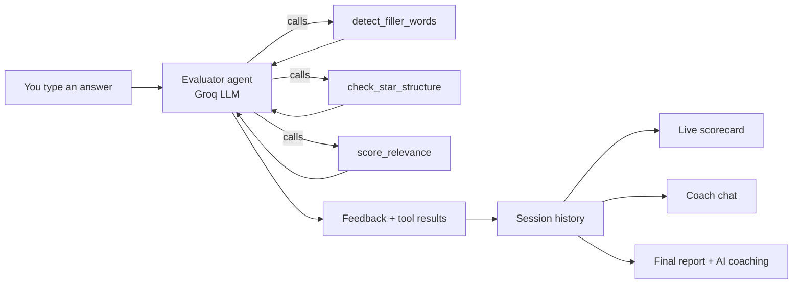

## 🎯 Prep Pilot — AI-Powered Interview Coach 🚀

Navigating interview preparation usually means rehearsing in front of a mirror with zero feedback, paying hefty fees for live mock interviews, or settling for generic chatbots that spit out vague, unmeasurable advice. Candidates are left guessing if their answers are actually structured, relevant, or professional.

**Prep Pilot App** changes the game. Built on Streamlit, this intelligent application serves as your personal interview simulator and coach.

### Key Features:

* 🎙️ Live Interview Simulation – Respond directly to tailored interview questions.
* 📊 Instant Structured Feedback – Know exactly how relevant, well-structured, and concise your answers are.
* 💬 On-Demand AI Coach – Dive deeper into your responses and chat with an AI mentor for real-time adjustments.
* 📈 Final Performance Reports – Walk away with a clear, data-driven report of your interview readiness.

## 🧠 How it works

PrepPilot uses an LLM **with tool calling**. The model doesn't just write feedback; it decides which analysis tools to run on your answer, reads their results, and then writes feedback grounded in that data.



---
## 📁 Project structure

```text
preppilot/
├── app.py                   # Streamlit UI (entry point)
├── config.py                # App name, tagline, icon, model
├── voice.py                 # Read-aloud (text-to-speech) for questions
├── interview_bank.py        # 50 questions: level, STAR flag, expected keywords
├── requirements.txt
├── .env.example             # Template for your API key
├── .streamlit/
│   └── config.toml          # Theme settings
├── core/
│   ├── llm.py               # Groq client + API key loading
│   ├── evaluator_agent.py   # Tool-calling answer evaluator
│   ├── agent.py             # "Ask the Coach" agent
│   ├── final_coach.py       # Final AI coaching report
│   ├── report.py            # Session metrics aggregation
│   └── session_manager.py   # In-memory session history
└── tools/
    ├── filler_words.py      # Filler word detection
    ├── relevance.py         # Keyword relevance score
    └── star_structure.py    # STAR component detection
```
### Using the app
1. Click **Start interview**.
2. Listen to the question (it plays automatically, or press 🔊), then type your answer.
3. On behavioural questions, choose **STAR guided** or **Free text**.
4. Click **Evaluate Answer** to see feedback, filler words, STAR coverage and relevance.
5. Use **Next →** to continue, **Ask Coach** for advice, and **Final Report** when you're done.

---
## 🛠 Tech stack

| Area | Technology |
|---|---|
| UI | [Streamlit](https://streamlit.io) |
| LLM | `openai/gpt-oss-20b` on [Groq](https://groq.com), accessed with the OpenAI Python SDK |
| AI pattern | Function / tool calling |
| Voice | Browser Web Speech API (`speechSynthesis`) |
| Config | `python-dotenv` |
| Language | Python 3.9+ |

---

